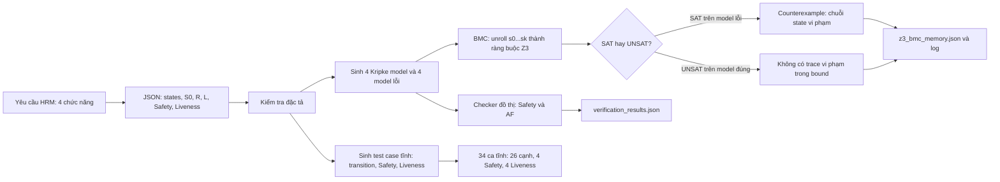
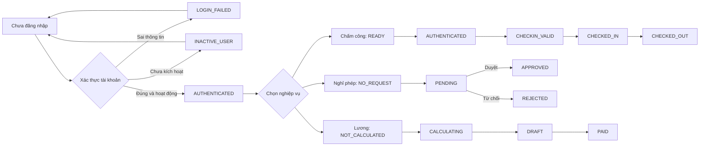
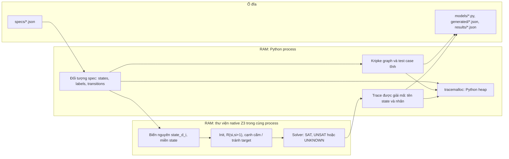

# Thiết kế trình bày: hai luồng, mô hình Kripke và bộ nhớ BMC

Tài liệu này dùng cho phần bảo vệ bài tập lớn. Bốn máy trạng thái được đặc tả riêng ở `verification/specs/*.json`: đăng nhập, chấm công, nghỉ phép, tính lương. `M = (S, S₀, R, L)` gồm tập trạng thái, trạng thái đầu, quan hệ chuyển tiếp và nhãn mệnh đề đúng ở mỗi trạng thái.

## Luồng 1 — từ đặc tả đến kết quả kiểm chứng



`generate_artifacts.py` đọc JSON, sinh mã Python tại `models/`, `faulty_models/` và ca kiểm thử tại `generated/`. `run_all.py` chạy checker đồ thị. `run_z3_demo.py` chạy Z3, ghi trace, thời gian và RAM. Các ca tĩnh và Z3 làm việc trên mô hình; chúng chưa gửi HTTP request tới dịch vụ HRM.

## Luồng 2 — nghiệp vụ mà bốn mô hình trừu tượng hóa



Đây là sơ đồ điều hướng nghiệp vụ để người xem nhận ra bốn chức năng. Các state cùng tên, ví dụ `AUTHENTICATED` trong login và attendance, thuộc **hai máy trạng thái khác nhau**. BMC hiện kiểm tra từng mô hình riêng, chưa kiểm chứng quan hệ liên dịch vụ hoặc điều kiện dữ liệu chấm công/nghỉ phép đầu vào của phép tính lương.

## Đặc tả, ràng buộc và test tương ứng

| Mô hình | Số state / cạnh | Ràng buộc Safety | Mệnh đề Liveness | Phản ví dụ trên model lỗi |
|---|---:|---|---|---|
| Login | 8 / 10 | Chỉ `AUTHENTICATING_ACTIVE` được vào `AUTHENTICATED` | Từ `AUTHENTICATING_ACTIVE`, cuối cùng có `authenticated` | `UNAUTHENTICATED → AUTHENTICATED` |
| Attendance | 6 / 7 | Vào `CHECKED_IN` phải từ `CHECKIN_VALID`; vào `CHECKED_OUT` phải từ `CHECKED_IN` | Từ `CHECKIN_VALID`, cuối cùng có `checked_in` | `AUTHENTICATED → CHECKED_OUT` |
| Leave | 4 / 5 | `APPROVED`/`REJECTED` chỉ tới từ `PENDING` | Từ `PENDING`, cuối cùng `approved` hoặc `rejected` | `NO_REQUEST → APPROVED` |
| Payroll | 4 / 4 | Tính theo thứ tự; `PAID` không về `DRAFT` | Từ `NOT_CALCULATED`, cuối cùng có `draft` | `PAID → DRAFT` |

`allowed_predecessors` trong đặc tả sinh các cạnh cấm. Mỗi cạnh hợp lệ có một test chuyển trạng thái; mỗi mô hình có một test âm Safety và một witness Liveness. Tổng cộng 34 test case ở `verification/generated/test_cases.md`. `formula` trong JSON là cách ghi mệnh đề cho báo cáo; checker đọc trực tiếp các trường trạng thái, cạnh, nhãn và predecessor, không phân tích cú pháp CTL tổng quát.

## Sơ đồ dữ liệu trong bộ nhớ



Mã state là vị trí của state trong mảng `states` của JSON, từ `0` đến `|S|-1`. Ví dụ trên login, `state_1_0 = 0` là `UNAUTHENTICATED` và `state_1_1 = 6` là `AUTHENTICATED`. Biến `state_d_i` biểu diễn state ở bước `i` trong truy vấn Safety có độ sâu `d`; các truy vấn độ sâu khác nhau có nhóm biến riêng.

Với Safety ở độ sâu `d`, solver kiểm tra `Init(s₀) ∧ R(s₀,s₁) ∧ ... ∧ R(s₍d₋₁₎,s_d) ∧ Forbidden(s₍d₋₁₎,s_d)`. `SAT` trả giá trị của từng `sᵢ`; `UNSAT` nghĩa là không có đường vi phạm ở độ sâu đó. Runner thử tăng dần tới bound bằng số state reachable. Với Liveness `AF(target)`, truy vấn tìm đường dài `|S_reachable|` mà mọi state đều tránh target; do `R` total và hữu hạn, một đường như vậy tạo được vòng lặp tránh target.

## Xem biến state và số đo RAM khi bảo vệ

Từ thư mục gốc dự án, dùng Python trong môi trường ảo:

```bash
python3 -m venv .venv
source .venv/bin/activate
python -m pip install -r verification/requirements-z3.txt
python verification/generate_artifacts.py
python verification/run_all.py
python verification/run_z3_demo.py --repeat 20
python verification/show_bmc_memory.py --feature all
```

Để trình bày ngắn một ca, dùng `python verification/show_bmc_memory.py --feature login`. Lệnh đọc kết quả Z3 đã lưu và in bảng `state_d_i`, mã state, nhãn đúng, cạnh đi vào, điểm vi phạm Safety. Nó cũng in RSS tiến trình, heap Python, `MemAvailable` hệ thống và RSS của từng vòng lặp. Các số đo là của **lần chạy `run_z3_demo.py` gần nhất**; chạy lại demo nếu đặc tả đã thay đổi. RSS bao gồm Python và phần native Z3; `tracemalloc` chỉ đo heap Python. `MemAvailable` là bộ nhớ toàn hệ thống, không phải bộ nhớ riêng của chương trình.

Kết quả mong đợi: bốn mô hình đúng `UNSAT` cho phản ví dụ Safety và Liveness; bốn mô hình được chèn cạnh lỗi `SAT` và có trace. `UNKNOWN` hoặc thiếu trace không được coi là PASS. Máy chấm có thể có số đo RAM khác, vì phụ thuộc hệ điều hành và các tiến trình khác.
